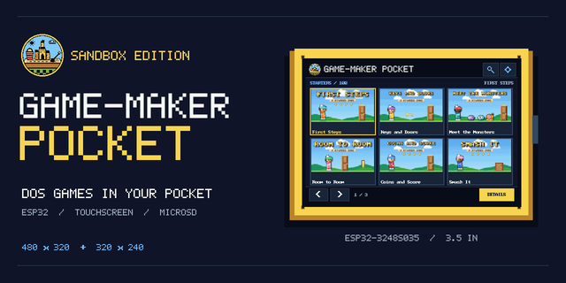

# Game-Maker Pocket



A pocket player for [Game-Maker: Sandbox Edition](https://github.com/lewismoten/GameMaker-SandboxEdition) games, on cheap ESP32 touch-screen boards. It plays the Starter lessons from the games' real DOS files (packed small), a library of games from a microSD card, the PC speaker sounds, and has touch controls for fingers and a stylus, a settings screen and a status strip. It pairs with [gamemaker-os](https://github.com/lewismoten/gamemaker-os).

Game-Maker: Sandbox Edition is a fork of RSD Game-Maker 3.0 (1991-1995), whose source was released under the MIT License in 2014. The play rules here (`src/gmcore.h`, `src/gmmon.h`) port that project's web engine, which follows the original `PLAYGAME.C`. See [NOTICE.md](NOTICE.md).

## Boards

| Board | Screen | Touch | PlatformIO env |
| --- | --- | --- | --- |
| ESP32-2432S028 ("Cheap Yellow Display") | 2.8 inch, 320 x 240 | XPT2046 resistive | `cyd-2432s028` |
| ESP32-3248S035 | 3.5 inch, 480 x 320, ST7796 | GT911 capacitive | `esp32-3248s035` |

Both have 4 MB flash and a microSD slot. Sound is the PC speaker only (GPIO 26); no Sound Blaster clips or music yet. The 2.8 inch boards come in several display revisions, so the first start walks you through a short display setup (mirror, orientation, colors, touch calibration).

## Build and flash

Install [PlatformIO](https://platformio.org/) (the core is enough), then from this folder:

```sh
pio run -e cyd-2432s028                                                       # build the 2.8 inch firmware
pio run -e cyd-2432s028 -t upload   --upload-port /dev/cu.usbserial-XXXX      # flash the program
pio run -e cyd-2432s028 -t uploadfs --upload-port /dev/cu.usbserial-XXXX      # the Starters (data/) into LittleFS, once
pio run -e esp32-3248s035                                                     # the 3.5 inch board: build,
pio run -e esp32-3248s035 -t upload   --upload-port /dev/cu.usbserial-XXXX    # flash the program,
pio run -e esp32-3248s035 -t uploadfs --upload-port /dev/cu.usbserial-XXXX    # and the data (LittleFS)
```

`/dev/cu.usbserial-XXXX` is a macOS example; `pio device list` shows your board's port on any system. Use a USB cable that carries data. If `pio` is not on your PATH it is at `~/.platformio/penv/bin/pio`. Each build bakes in its git hash and date; the serial command `FW` (115200 baud) prints them.

## Updating the web flasher

`docs/` is the GitHub Pages site (Settings, Pages, branch `main`, folder `/docs`): an install page where a visitor picks a board and flashes it from Chrome or Edge with the bundled [ESP Web Tools](docs/ewt/THIRD-PARTY.txt). After a firmware or `data/` change, run `scripts/build-pages.sh`. It builds both boards (`pio run`, then `-t buildfs` for the library image), copies bootloader, partitions, firmware and LittleFS images into `docs/fw/<env>/`, and rewrites `docs/manifest-28.json` and `docs/manifest-35.json` with the git hash and date as the version. The page itself (`docs/index.html`, `install.js`) is edited by hand; fonts are in `docs/fonts/`. Commit `docs/`; Pages serves the files as they are. Flash offsets: 0x1000 bootloader, 0x8000 partitions, 0x10000 firmware, 0x110000 LittleFS.

## Getting games onto it

Games can also live in the board's own flash: every `NAME.GMP` in LittleFS `/games` is listed beside the card's (tag: On board; if a game is on both, the card's copy wins). The web flasher's "Player + starter games" image is built by `scripts/build-pages.sh` from five exported games (`GAMEMAKER_DIR`, default `../GameMaker`).

**Send games over USB:** the install page's Send games tab (`docs/send.js`, `docs/pocketdisk.js`) talks to the firmware over Web Serial (Chrome or Edge). With the board on its game list it shows the games and free space, sends `.GMP` files (up to 2 MB each, every chunk with a CRC-32, written to a temporary file and renamed, so a cable pulled half way leaves the old game as it was), removes games and sets their order (up to 256). A replacement is checked as if the old copy stays, because both exist until the transfer ends. The serial `DISK ...` commands and their rules are in `src/serialfs.h`; the page's code is tested with `node host/pocketdisktest.mjs`.

The 106 Starters in `data/` go into LittleFS with `uploadfs`. More games go on a FAT32 microSD card, in a `/pocket` folder, one `.GMP` file each. Game packs and the library index are made by Game-Maker: Sandbox Edition, not by this repository:

- `data/` (`games.txt`, `cards.pak`, `small.pak`, `thumbs.pak`, `library.jsonl`, `font.bin`) is the output of `cd web && npx vite-node scripts/pocketData.ts --out <dir>` in a Game-Maker: Sandbox Edition checkout (`web/scripts/pocketData.ts`, with `pocketArt.ts` for the icons and splash).
- A card full of games: `npx vite-node scripts/pocketData.ts --gmp /Volumes/POCKET` writes every public non-Starter game that fits, as `.GMP` files, into `/Volumes/POCKET/pocket/`.
- One game: on that site's game page, Download, Pocket Player (microSD) saves `NAME.GMP`; copy it into `/pocket` on the card.
- `library.jsonl` (the categories, tabs and title screens the board's library browser shows) is written by the same packer (`web/src/export/pocketLibrary.ts`). The `.GMP` format is in `web/src/export/pocketFile.ts`; the card for gamemaker-os is `web/scripts/gmosCard.ts`. The install page and prebuilt firmware images are in that repository's `web/public/pocket/`; this repository's `docs/` is the copy GitHub Pages serves, and `web/public/pocket/` is the site's copy, so rebuild both when firmware changes.

After changing the packed data format here, repack in Game-Maker: Sandbox Edition and copy `data/` back. Details and field notes: [docs/FIRMWARE.md](docs/FIRMWARE.md) and [host/README.md](host/README.md).

## Tools

Python 3 with `pyserial` (PlatformIO's Python has it: `~/.platformio/penv/bin/python`). Run from this folder. Board letters (A, B, C) are set on a board with the serial command `ID set X`.

- `scripts/pocketStatus.py PORT "text"` shows a banner on the board without resetting it (`open_port` is the no-reset port helper the others use); `--find` lists which board is on which port.
- `scripts/pocketWalk.py --board C scripts/pocket-walks/first-run.txt` plays a script of taps and holds over serial, with expectations and optional camera pictures (the camera step needs a Game-Maker checkout, `GAMEMAKER_DIR`).
- `scripts/pocketBoardCheck.py`, `pocketHeldTrace.py`: check held input and trace it on a board.
- `scripts/pocketIconsShot.py OUT game-id`: draws the button icons the firmware picks, on the Mac.
- `scripts/pocket-heap-test.py`, `pocket-heap-audit.py`, `pocket-inventory-test.py`: heap and inventory checks (the audit also needs a Game-Maker checkout).

## Host tests

The play loop, cards, controls and setup flow have no board code and are tested on the Mac with a C++17 compiler and zlib: `host/*.cpp` (see [host/README.md](host/README.md); for example `c++ -std=c++17 -O1 -Isrc host/controlstest.cpp -lz && ./a.out`). Some of those tests are run by scripts in Game-Maker: Sandbox Edition that compare them with the real engine.

## License

MIT, see [LICENSE](LICENSE). Credits for libraries, the font, AI tools and the games' origins: [NOTICE.md](NOTICE.md). Changes: [CHANGELOG.md](CHANGELOG.md).
